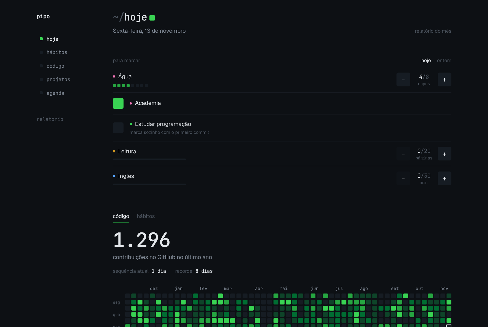
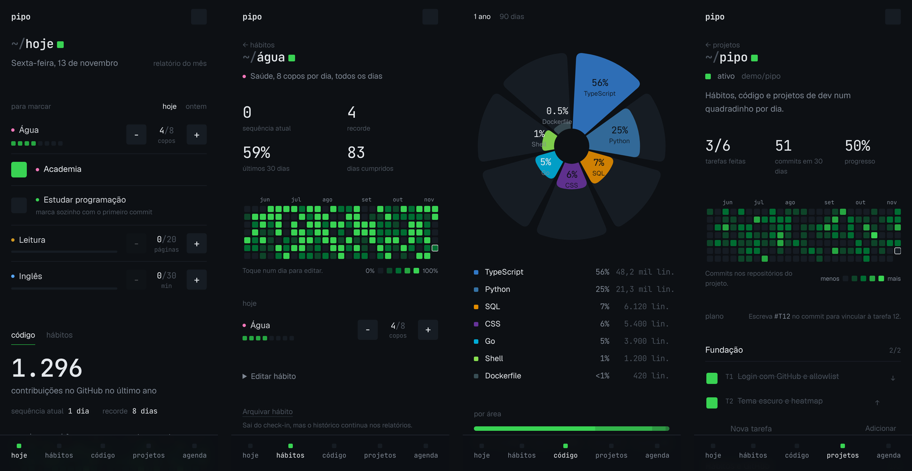
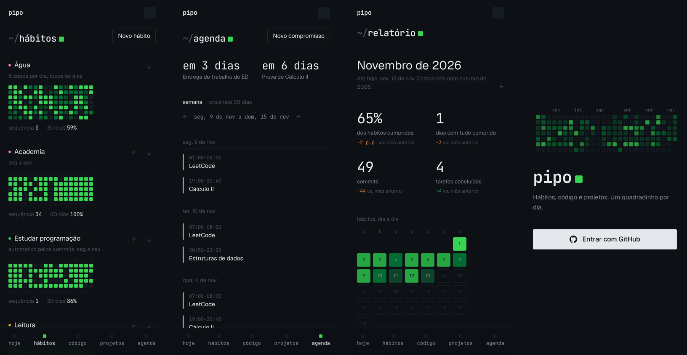
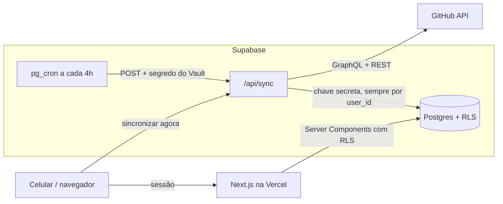

# pipo

Hábitos, código e projetos de um dev na estética do gráfico de contribuições do GitHub. **Um quadradinho por dia.**

O pipo junta num lugar só a sua atividade no GitHub, os hábitos do dia a dia, o plano de execução dos seus projetos e a agenda de estudos. Feito para o celular (instalável na tela inicial do iPhone), em tema escuro, sem notificações e sem IA: tudo é determinístico e sob demanda.







> Os prints usam o modo demonstração (dados fictícios). Veja [Rodando localmente](#rodando-localmente).

## O que tem

- **Hoje.** Check-in dos hábitos com um toque (ou de ontem), heatmap do ano de contribuições e de hábitos, agenda do dia, próxima prova ou entrega e a próxima tarefa de cada projeto.
- **Hábitos.** Sim/não, com meta e unidade (8 copos, 20 páginas, 60 min) ou **automáticos**: "estudar programação" se marca sozinho no dia em que você fizer um commit. Agenda por dias da semana (ex.: seg a sex), heatmap por hábito com intensidade proporcional à meta, sequência atual e recorde, edição de qualquer dia anterior.
- **Código.** Sincronização com o GitHub a cada 4 horas (ou na hora, com um botão): contribuições, commits com filtros, **linguagens que você mais programa** (pelas linhas alteradas em cada commit, não pelo tamanho do repositório) e **bibliotecas que mais usa**, agrupadas em categorias editáveis.
- **Projetos.** Repositórios vinculados, frequência de commits, plano com marcos e tarefas numeradas (T1, T2…). Escreva `#T12` na mensagem do commit e ele aparece dentro da tarefa 12; em projetos de programação, o commit também conclui a tarefa.
- **Agenda.** Aulas, estudos, provas e entregas, com recorrência semanal, cancelamento de um dia só e contagem regressiva.
- **Relatório mensal.** % de cumprimento de cada hábito, dias com tudo cumprido, melhor sequência, commits, repositório mais ativo, linguagens do mês, tarefas concluídas por projeto, sempre comparando com o mês anterior.

## Stack

| | |
|---|---|
| App | Next.js 16 (App Router, Cache Components, Server Actions) + TypeScript |
| Estilo | Tailwind CSS 4 com tokens próprios; gráficos em SVG feitos à mão |
| Banco e login | Supabase: Postgres, Auth (login com GitHub), RLS, pg_cron, pg_net, Vault |
| Testes | Vitest (143 testes) |
| Deploy | Vercel, com CI no GitHub Actions (lint, typecheck, testes, build) |

## Arquitetura



### Decisões e por quê

- **O "dia" é sempre local.** Todo commit e todo registro guarda o instante e a data local no fuso do usuário (`America/Sao_Paulo` por padrão). Um commit às 23h no Brasil não cai no dia seguinte por causa do UTC. Toda conversão passa por `src/lib/dates.ts`, com testes que cobrem horário de verão.
- **Uso pessoal hoje, pronto para SaaS.** Toda tabela tem `user_id` e RLS. As chaves estrangeiras são compostas (`(id, user_id)`), então o próprio banco impede que um registro aponte para dados de outro usuário, sem subconsultas nas policies. O acesso é limitado por um trigger de allowlist em `auth.users`; abrir para outros devs é remover o trigger.
- **Login e dados do GitHub são separados.** O login pede só a identidade. A sincronização usa um token fine-grained somente leitura atrás da interface `GitHubTokenProvider`; no SaaS, ela vira um GitHub App com token por usuário, sem mexer no resto.
- **Cache próprio e sincronização incremental.** Nenhuma página chama o GitHub. Cada repositório guarda quando foi sincronizado; só repositórios com push novo são consultados, e a análise de arquivos por commit acontece aos poucos. Cada execução respeita um orçamento de tempo e de rate limit e retoma de onde parou (`src/lib/github/sync.ts`).
- **Agendamento pelo banco.** O cron da Vercel no plano gratuito só roda uma vez por dia; o `pg_cron` do Supabase chama `/api/sync` a cada 4 horas, lendo a URL e o segredo do Vault.
- **Agregados no Postgres.** Commits por dia, por linguagem, por repositório e o uso de bibliotecas são funções SQL `security invoker` (respeitam o RLS), sem esbarrar no limite de linhas da API.
- **Lógica pura e testada.** Streaks com agenda semanal, % de cumprimento, relatório mensal, fuso horário, parser de `#T12`, detecção de linguagem, parsers de `package.json`/`requirements.txt`/`pyproject.toml` e a sincronização inteira (com GitHub simulado e banco em memória) têm testes.
- **Sem kit de componentes nem biblioteca de gráficos.** Heatmap, gráfico radial de "pétalas" e barras são SVG/HTML próprios: leves e com cara de pipo.

A especificação completa está em [`docs/SPEC.md`](docs/SPEC.md).

## Rodando localmente

Requisitos: Node 22+.

### Só para ver as telas (sem banco)

```bash
npm install
PIPO_DEMO=1 npm run dev
```

O modo demonstração usa dados fictícios e dispensa login. Ele só existe em desenvolvimento e nunca liga em produção.

### Com o Supabase

```bash
npm install
cp .env.example .env.local    # preencha NEXT_PUBLIC_SUPABASE_URL e NEXT_PUBLIC_SUPABASE_PUBLISHABLE_KEY
npm run dev
```

Banco local (Docker): `npx supabase start` aplica as migrations de `supabase/migrations` e o seed de `supabase/seed.sql`. Para um projeto remoto: `npx supabase link --project-ref <ref>` e `npx supabase db push`.

### Variáveis de ambiente

| Variável | Onde | Para quê |
|---|---|---|
| `NEXT_PUBLIC_SUPABASE_URL` | público | URL do projeto Supabase |
| `NEXT_PUBLIC_SUPABASE_PUBLISHABLE_KEY` | público | chave publicável (o RLS protege os dados) |
| `NEXT_PUBLIC_SITE_URL` | público | URL do app, usada no retorno do login |
| `SUPABASE_SECRET_KEY` | servidor | grava o cache do GitHub na sincronização |
| `GITHUB_TOKEN` | servidor | token fine-grained somente leitura |
| `CRON_SECRET` | servidor | opcional; por padrão o segredo do pg_cron fica no Vault |

## Conectando o GitHub

1. **Login.** Crie um OAuth App no GitHub (Settings → Developer settings → OAuth Apps) com callback `https://<ref>.supabase.co/auth/v1/callback` e ative o provider GitHub no Supabase (Authentication → Sign In / Providers). Em URL Configuration, coloque a URL do app como Site URL e `<url>/auth/callback` em Redirect URLs.
2. **Token de leitura.** Em GitHub → Settings → Developer settings → Fine-grained tokens, crie um token com acesso a **todos os repositórios** e as permissões **Contents: read** e **Metadata: read**. Salve como `GITHUB_TOKEN` na Vercel.
3. **Chave secreta.** Em Supabase → Settings → API Keys, copie a secret key para `SUPABASE_SECRET_KEY` na Vercel.
4. **Sincronização automática.** O segredo do agendador é gerado dentro do banco (migration `cron_secret_in_vault`) e conferido pela função `verify_cron_secret`, então não precisa ir para a Vercel. Falta só a URL do app, uma vez, no SQL Editor do Supabase:

   ```sql
   select vault.create_secret('https://SEU-APP.vercel.app', 'pipo_app_url');
   ```

Depois disso, abra **código → Sincronizar agora**. A primeira vez traz o último ano e pode levar alguns minutos (e algumas rodadas para analisar as linguagens de todos os commits).

## Instalando no iPhone

Abra o app no Safari, toque em compartilhar e em **Adicionar à Tela de Início**. Ele abre em tela cheia, sem a barra do navegador.

## Scripts

| Script | O que faz |
|---|---|
| `npm run dev` | servidor de desenvolvimento (`PIPO_DEMO=1` para o modo demonstração) |
| `npm run check` | lint + typecheck + testes |
| `npm test` | testes |
| `npm run build` | build de produção |
| `npm run db:types` | regenera os tipos do banco (Supabase CLI logada) |

## Estrutura

```
src/
  app/(app)/        telas: hoje, hábitos, código, projetos, agenda, relatório
  app/api/sync/     sincronização com o GitHub (cron e manual)
  components/       heatmap, gráfico radial, check-in, formulários…
  lib/              lógica pura e testada (datas, streaks, hábitos, relatório, linguagens, manifests, #T12)
  lib/github/       cliente da API, consultas, transformações e orquestrador da sincronização
  lib/data/         consultas ao banco (Server Components)
supabase/
  migrations/       esquema versionado, RLS e funções SQL
  seed.sql          dados de exemplo para desenvolvimento local
docs/SPEC.md        especificação e registro de decisões
```

## Fora de escopo (por enquanto)

IA, notificações, múltiplos usuários abertos e app nativo. Ideia futura: gerar uma imagem de papel de parede com os seus heatmaps.
